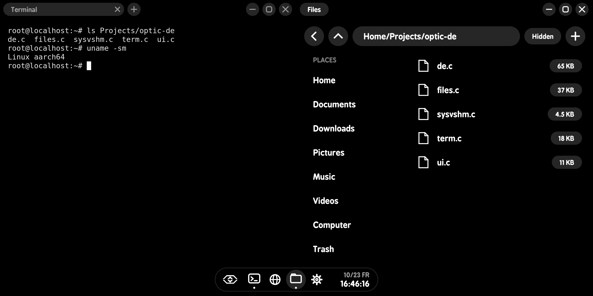
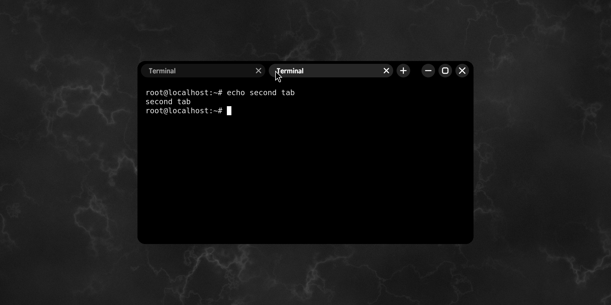
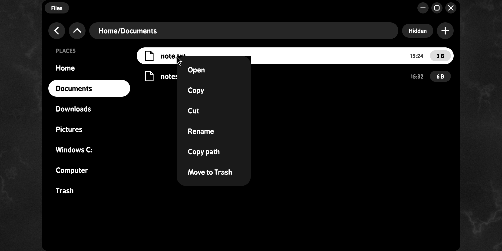
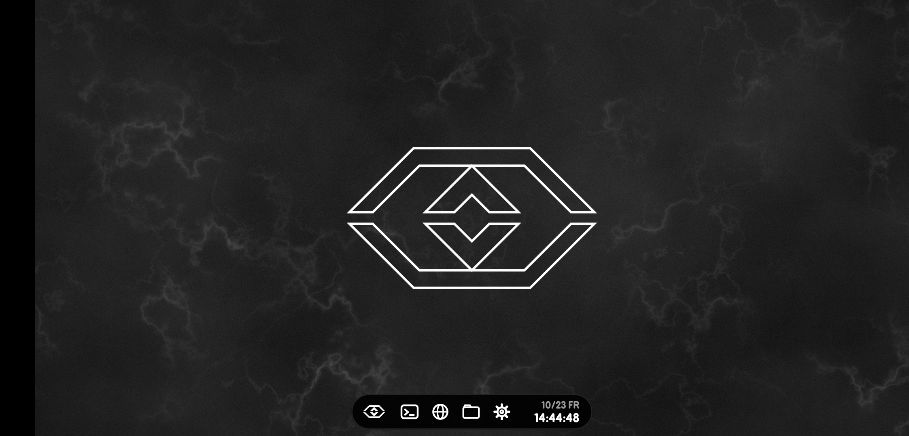
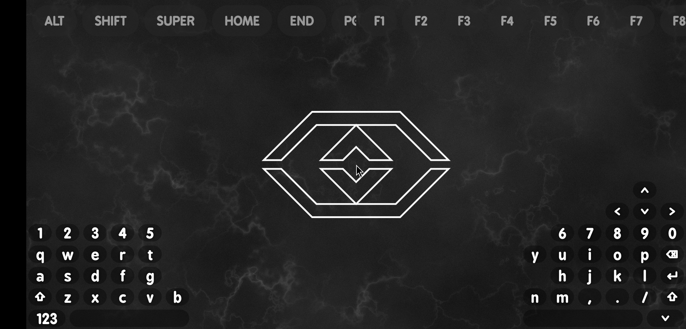

# Optic DE

A small desktop environment for X11, written from scratch in C, in the black-and-white
**MinUI** look: round pills, line icons, nothing else. One window manager process with its
taskbar and wallpaper uses about **15 MB of RAM**.

It was built to run on an Android phone (inside Debian, through the
[Optic Suite](#on-android) app), and it also runs on an ordinary **Debian PC**. See
**[docs/SETUP-DEBIAN.md](docs/SETUP-DEBIAN.md)**.



## What's in it

| Program | What it does |
|---|---|
| `optic-de` | Window manager, taskbar, app menu and wallpaper in one process |
| `optic-term` | **Optic Terminal**: xterm with browser-style tabs in the title bar |
| `optic-files` | **Optic Files**: a file manager |
| `optic-settings` | **Optic Settings**: wallpaper, taskbar, clock, screen size, about |
| `optic-session` | Starts the session (themes, scaling, D-Bus), then `optic-de` |
| `optic-firefox` | Firefox with Optic's profile: tabs in the title bar, Optic's buttons |
| `libsysvshm.so` | Only for Android / proot: System V shared memory and a Wine fix (not needed on a PC) |

### The desktop (`optic-de`)
- **Wallpaper:** the Optic logo on a stone texture, or plain black.
- **Taskbar:** a pill that hides itself and slides back in when the pointer reaches the bottom edge. It holds the Optic button (app menu), Terminal, Firefox, Files and Settings, other open apps, and a stacked clock (date and weekday over the time, with seconds).
- **Windows:**
  - MinUI title bars: the title in a pill, round minimise / maximise / close buttons;
  - rounded corners on every window, including Firefox, which draws its own title bar;
  - move a window by its title bar, resize from its edges and bottom corners, double-click the title to maximise.
- **Snapping (Windows-style):**
  - pull a window to the top and a card of layouts drops in (halves, thirds, quarters, full);
  - push a window against the left or right side for that half, or near a corner for a quarter;
  - snapped windows sit flush, with no gaps.
- **App menu:** the Optic button lists every installed app with a `.desktop` file.

### Optic Terminal


- Each tab is a pill showing its title and a ×; the round **+** opens a new tab.
- Keys: **Ctrl+Shift+T** new tab, **Ctrl+Shift+W** close tab, **Ctrl+PageUp / PageDown** switch.
- Drag the tab strip to move the window; double-click it to maximise.

### Optic Files


- **Layout:** back and up buttons, the path in a pill (tap it to type a path), a Hidden toggle, and **+** for a new folder. A Places list (Home, Documents, Downloads, Pictures, Music, Videos, Windows C:, Computer, Trash) sits beside rows with size pills and dates.
- **Opening:** double-click opens. Folders open in place; pictures, PDFs, video and web pages open in Firefox; text opens in nano; `.exe` files open in Wine.
- **Right-click:**
  - on a file: Open, Copy, Cut, Rename, Copy path, Move to Trash;
  - on empty space: Paste here, New folder, Show hidden files, Terminal here;
  - in Trash: Restore, Delete forever, Empty Trash.
- **Background work:** copies and moves run in the background, and the list follows changes by itself.
- **Keys:** arrows, Enter, Backspace (up), Delete (to Trash), F2 (rename), Ctrl+C / X / V, Ctrl+H (hidden files), Ctrl+L (type a path).

## Building

```sh
make            # optic-de, optic-term, optic-files, optic-settings, libsysvshm.so
sudo make install
```

Everything installs under `/opt/optic-de`, with links in `/usr/local/bin` and an **Optic** session
for login managers. `sudo make uninstall` removes it all. The full walk-through for a Debian PC,
including the packages to install first, is in **[docs/SETUP-DEBIAN.md](docs/SETUP-DEBIAN.md)**.

## On Android



On Android, Optic DE runs inside Debian under proot. The Optic Suite app starts an X server
(TigerVNC's Xvnc) and draws it full screen with its own client: GPU-uploaded, no tearing,
60 fps. The touchscreen works as a trackpad:
- tap to click, two-finger tap to right-click, two fingers to scroll;
- tap then touch again to drag (lift and touch again within ~0.4 s to keep dragging);
- pinch to zoom.

A three-finger swipe down brings up Optic's own split keyboard:



- **Top strip:** editing keys, and Ctrl / Alt / Shift / Super as on/off toggles, plus F1–F12.
- **Bottom corners:** QWERTY under each thumb, an arrow cluster, and Left / wheel / Right mouse keys.

The phone-only parts of `optic-session` run only when `OPTIC_ANDROID=1`. `libsysvshm.so` exists for the same reason: Android has no System V shared memory, and it refuses Wine's code pages.

## Status

Optic DE is young. It's used daily on Android; the **Debian PC setup is new and less tested**, so please report what breaks.
It supports one monitor. There's no compositor, notifications, system tray or workspaces, which is part of why it's so light.

## License

Optic DE is free software under the **GNU General Public License v3.0**. See [LICENSE](LICENSE).

The bundled font, **BPreplay** (`bpreplay_bold.otf`), is by backpacker (backpacker.gr). It's
included under its own license and is not covered by the GPL.
